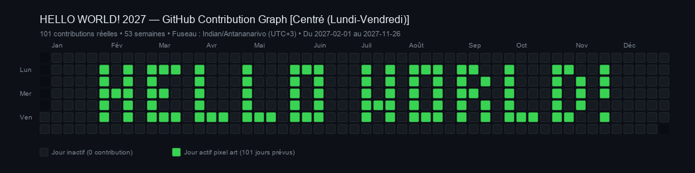
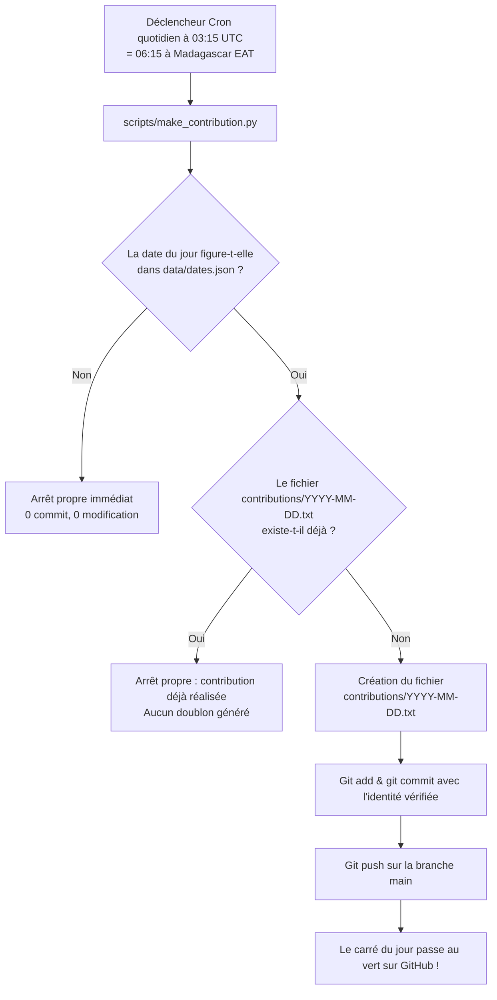

# 🟩 HELLO WORLD! 2027 — GitHub Contribution Graph Pixel Art

Système entièrement automatisé permettant de dessiner le texte **`HELLO WORLD!`** sur votre calendrier de contributions GitHub tout au long de l'année civile **2027**, via **GitHub Actions** et **Python 3.12**.

Aucun serveur externe, aucun VPS, aucun coût et aucune intervention manuelle quotidienne ne sont requis. Votre ordinateur peut rester éteint.



---

## Sommaire

1. [Fonctionnement du projet](#1-fonctionnement-du-projet)
2. [Structure des fichiers](#2-structure-des-fichiers)
3. [Le Pixel Art & Analyse du centrage](#3-le-pixel-art--analyse-du-centrage)
4. [Règles cruciales d'attribution des commits GitHub](#4-règles-cruciales-dattribution-des-commits-github)
5. [Déploiement pas-à-pas sur GitHub](#5-déploiement-pas-à-pas-sur-github)
6. [Configuration des permissions GitHub Actions](#6-configuration-des-permissions-github-actions)
7. [Procédure de test immédiate (sans attendre 2027)](#7-procédure-de-test-immédiate-sans-attendre-2027)
8. [Vérification sur le profil GitHub](#8-vérification-sur-le-profil-github)
9. [Dépannage & Questions fréquentes (FAQ)](#9-dépannage--questions-fréquentes-faq)
10. [Personnalisation (modifier le texte ou les dates)](#10-personnalisation-modifier-le-texte-ou-les-dates)

---

## 1. Fonctionnement du projet

Chaque jour de l'année civile 2027, le robot GitHub Actions se réveille automatiquement :



- **Fuseau horaire** : `Indian/Antananarivo` (Madagascar, UTC+3).
- **Heure d'exécution** : `03:15 UTC` (soit `06:15` du matin à Madagascar).
- **Off-peak schedule** : La minute `:15` a été spécifiquement choisie pour éviter les engorgements et retards fréquents des runners GitHub Actions qui surviennent à la minute `:00`.
- **Idempotence garantie** : Si une contribution a déjà été enregistrée pour une date, le script ne crée aucun commit en double.

---

## 2. Structure des fichiers

```text
hello-world-2027/
│
├── .github/
│   └── workflows/
│       └── hello-world-2027.yml   # Workflow d'automatisation GitHub Actions
│
├── contributions/
│   └── .gitkeep                   # Dossier recevant les fichiers de contribution
│
├── scripts/
│   ├── make_contribution.py       # Logique de vérification et création d'une contribution
│   ├── validate_dates.py          # Validation stricte des dates, du motif et du centrage
│   └── preview_pixel_art.py       # Générateur de prévisualisation ASCII et image PNG
│
├── data/
│   ├── dates.json                 # 101 dates ISO retenues (parfaitement centrées)
│   └── dates_proposal.json        # 101 dates de la proposition initiale (pour référence)
│
├── assets/
│   └── calendar_preview.png       # Rendu haute définition du calendrier pixel art
│
├── calendar_preview.png           # Rendu à la racine du dépôt pour affichage README
├── README.md                      # Documentation complète en français
├── requirements.txt               # Dépendances Python (Pillow pour l'image PNG)
└── .gitignore                     # Exclusion des fichiers temporaires
```

---

## 3. Le Pixel Art & Analyse du centrage

Le texte à dessiner est **`HELLO WORLD!`** composé d'une police pixel 3 × 5 :

```text
■·■·■■■·■···■···■■■···■·■·■■■·■■··■···■■··■
■·■·■···■···■···■·■···■·■·■·■·■·■·■···■·■·■
■■■·■■··■···■···■·■···■·■·■·■·■■··■···■·■·■
■·■·■···■···■···■·■···■■■·■·■·■·■·■···■·■··
■·■·■■■·■■■·■■■·■■■···■·■·■■■·■·■·■■■·■■··■
```

### Décomposition des 101 pixels actifs :
- `H` : 11 pixels
- `E` : 10 pixels
- `L` : 7 pixels
- `L` : 7 pixels
- `O` : 12 pixels
- *(Espace de 3 colonnes)*
- `W` : 11 pixels
- `O` : 12 pixels
- `R` : 10 pixels
- `L` : 7 pixels
- `D` : 10 pixels
- `!` : 4 pixels
- **Total exact : 101 contributions.**

### Analyse du centrage dans la grille GitHub 2027 (53 colonnes × 7 lignes) :

Le calendrier de l'année civile 2027 commence le **vendredi 1er janvier 2027** et se termine le **vendredi 31 décembre 2027**. Il comporte **53 semaines (colonnes)** :

1. **Centrage horizontal (Colonnes)** :
   - Largeur du texte : **43 colonnes**.
   - Colonnes totales : **53 colonnes** (0 à 52).
   - Marge gauche : **5 colonnes** (semaines 0 à 4).
   - Texte actif : **colonnes 5 à 47**.
   - Marge droite : **5 colonnes** (semaines 48 à 52).
   - **Résultat : Centrage horizontal parfait et symétrique (5 colonnes de chaque côté).**

2. **Centrage vertical (Lignes des jours de la semaine)** :
   - Hauteur du texte : **5 lignes**.
   - Nombre de lignes du calendrier GitHub : **7 lignes** (Ligne 0 = Dimanche, Ligne 6 = Samedi).
   - *Dans la proposition de départ (dates_proposal.json)* : le texte était placé sur les lignes 0 à 4 (Dimanche à Jeudi). Cela laissait 0 jour de marge en haut et 2 jours en bas (Vendredi et Samedi vides). Le texte était donc collé en haut.
   - *Dans la version validée (data/dates.json)* : le texte est décalé d'une ligne vers le bas (lignes 1 à 5, du Lundi au Vendredi).
     - Marge en haut : **1 jour** (Dimanche vide).
     - Texte : **5 jours** (Lundi à Vendredi).
     - Marge en bas : **1 jour** (Samedi vide).
     - **Résultat : Centrage vertical parfait (1 jour au-dessus, 1 jour en-dessous).**
     - Période des 101 contributions centrées : du **lundi 01/02/2027** au **vendredi 26/11/2027**.

---

## 4. Règles cruciales d'attribution des commits GitHub

> [!IMPORTANT]
> Pour qu'un commit soit comptabilisé sur votre profil GitHub et apparaisse en vert sur votre graphique de contributions, GitHub applique des règles très strictes :

1. **Le dépôt doit être public** (ou si vous le mettez en privé, vous devez cocher l'option *"Include private contributions on my profile"* dans les paramètres de votre profil GitHub).
2. **Le commit doit être poussé sur la branche par défaut** (ici `main`).
3. **L'adresse e-mail de l'auteur du commit DOIT être associée à votre compte GitHub** :
   - Si un robot signe un commit avec `github-actions[bot]@users.noreply.github.com`, GitHub attribuera le commit au bot GitHub Actions, et **aucun carré vert n'apparaîtra sur votre profil personnel**.
   - **Notre solution intégrée** : Le workflow configure automatiquement l'identité Git avec votre identifiant GitHub personnel et votre adresse e-mail no-reply officielle :
     ```bash
     git config user.name "${{ vars.GIT_USER_NAME || github.actor }}"
     git config user.email "${{ vars.GIT_USER_EMAIL || format('{0}+{1}@users.noreply.github.com', github.actor_id, github.actor) }}"
     ```
   - Pour une garantie à 100%, vous pouvez définir deux variables dans votre dépôt (voir section 5).

---

## 5. Déploiement pas-à-pas sur GitHub

### Étape 1 : Créer le dépôt distant sur GitHub
1. Rendez-vous sur [GitHub - New repository](https://github.com/new).
2. Nom du dépôt : `hello-world-2027`.
3. Visibilité : **Public** (recommandé pour un affichage direct sur le profil).
4. Ne pas cocher "Add a README" ni ".gitignore" (le projet contient déjà tout).
5. Cliquez sur **Create repository**.
   *(Votre URL sera : `https://github.com/Rabeveloniaina/hello-world-2027.git`)*.

### Étape 2 : Envoyer le code source depuis votre machine
Ouvrez un terminal PowerShell dans le dossier du projet (`c:\Users\WINDOWS 10\Desktop\ENI\HELLO`) et exécutez :

```powershell
# 1. Initialiser le dépôt Git local
git init -b main

# 2. Configurer votre identité locale
git config user.name "Rabeveloniaina"
git config user.email "votre-email@exemple.com"

# 3. Ajouter tous les fichiers
git add .

# 4. Effectuer le premier commit
git commit -m "feat: initial commit for HELLO WORLD! 2027 pixel art automation"

# 5. Définir le dépôt distant
git remote add origin https://github.com/Rabeveloniaina/hello-world-2027.git

# 6. Pousser vers GitHub
git push -u origin main
```

---

## 6. Configuration des permissions GitHub Actions

Pour que GitHub Actions ait le droit de créer et pousser des commits automatiquement, activez la permission d'écriture :

1. Sur GitHub, ouvrez votre dépôt `hello-world-2027`.
2. Allez dans **Settings** (en haut à droite du dépôt).
3. Dans le menu de gauche, déroulez **Actions** > cliquez sur **General**.
4. Descendez jusqu'à la section **Workflow permissions**.
5. Cochez : **Read and write permissions**.
6. Cochez : **Allow GitHub Actions to create and approve pull requests**.
7. Cliquez sur le bouton vert **Save**.

### (Recommandé) Configurer vos variables d'identité Git :
Dans le même menu **Settings** :
1. Cliquez sur **Secrets and variables** > **Actions** > onglet **Variables**.
2. Cliquez sur **New repository variable** :
   - Nom : `GIT_USER_NAME` | Valeur : votre nom ou pseudo GitHub (ex: `Rabeveloniaina`).
3. Cliquez à nouveau sur **New repository variable** :
   - Nom : `GIT_USER_EMAIL` | Valeur : l'adresse e-mail vérifiée de votre compte GitHub (ou votre e-mail `ID+username@users.noreply.github.com` visible dans [GitHub Email Settings](https://github.com/settings/emails)).

---

## 7. Procédure de test immédiate (sans attendre 2027)

Vous n'avez pas besoin d'attendre 2027 pour vérifier que tout fonctionne parfaitement ! Deux méthodes de test sont disponibles :

### Méthode A : Test local sur votre machine

```powershell
# 1. Valider l'intégrité mathématique et calendaire des dates
python scripts/validate_dates.py

# 2. Prévisualiser le dessin dans la console et générer le PNG
python scripts/preview_pixel_art.py

# 3. Simuler une contribution programmée en mode DRY-RUN (aucun fichier créé)
python scripts/make_contribution.py --date 2027-02-01 --dry-run

# 4. Tester le comportement sur une date hors calendrier (ex: aujourd'hui)
python scripts/make_contribution.py
# -> Affiche : [INFO] La date n'est PAS une date de contribution planifiée. Aucune action requise.
```

### Méthode B : Test manuel dans GitHub Actions (`workflow_dispatch`)

1. Allez dans l'onglet **Actions** de votre dépôt GitHub.
2. Dans la colonne de gauche, cliquez sur **HELLO WORLD! 2027 Pixel Art Automation**.
3. Cliquez sur le menu déroulant **Run workflow** à droite.
4. Dans le champ `Date de simulation`, saisissez une date programmée : `2027-02-01`.
5. Cochez la case **Mode simulation (dry-run)**.
6. Cliquez sur le bouton vert **Run workflow**.
7. Consultez les logs : vous verrez le message `[DRY-RUN] Simulation réussie : la contribution #1 pour le 2027-02-01 est valide.` et aucun commit ne sera poussé.

---

## 8. Vérification sur le profil GitHub

Lorsqu'une contribution réelle est poussée par le workflow :
1. Allez sur votre profil GitHub : `https://github.com/Rabeveloniaina`.
2. Descendez jusqu'au bloc **Contribution activity**.
3. Dans la liste des années sur la droite, cliquez sur **2027**.
4. Le carré correspondant à la journée programmée apparaît en vert clair ou foncé.
5. Au fil des mois de l'année 2027, les lettres **`HELLO WORLD!`** apparaîtront progressivement pour former le pixel art complet au 26 novembre 2027.

---

## 9. Dépannage & Questions fréquentes (FAQ)

### Pourquoi les commits n'apparaissent-ils pas en vert sur mon profil ?
Vérifiez les 4 causes courantes :
1. **L'e-mail du commit** : Assurez-vous que la variable `GIT_USER_EMAIL` correspond exactement à l'adresse e-mail enregistrée et vérifiée sur votre compte GitHub ([Vérifier ici](https://github.com/settings/emails)).
2. **La branche** : Les commits doivent être sur la branche `main` (branche par défaut).
3. **Visibilité du dépôt** : Si le dépôt est privé, rendez-vous dans les paramètres de votre profil GitHub et cochez *"Include private contributions on my profile"*.
4. **Délai de mise en cache** : GitHub peut mettre entre 5 et 15 minutes pour actualiser le cache visuel de la grille de contributions.

### Que se passe-t-il si GitHub Actions a du retard un matin ?
L'exécution est planifiée à 03:15 UTC (06:15 heure de Madagascar). Même si les serveurs de GitHub subissent un délai temporaire d'une ou deux heures, le script s'exécute le même jour civil et le commit sera horodaté pour cette journée.

### Comment éviter qu'un test manuel pollue mon calendrier ?
Utilisez toujours le paramètre `--dry-run` (ou la case à cocher en mode manuel). De plus, si vous devez tester la création d'un vrai commit avant 2027, supprimez simplement le fichier de test créé dans `contributions/` et poussez la suppression.

---

## 10. Personnalisation (modifier le texte ou les dates)

Pour régénérer les dates ou adapter le motif :
- Les glyphes 3 × 5 sont définis dans le dictionnaire `FONT_3x5` des scripts `scripts/preview_pixel_art.py` et `scripts/validate_dates.py`.
- Pour basculer entre la version parfaitement centrée et la proposition de départ :
  ```powershell
  # Aperçu du centrage parfait (lignes 1 à 5)
  python scripts/preview_pixel_art.py --mode centered

  # Aperçu de la proposition initiale (lignes 0 à 4)
  python scripts/preview_pixel_art.py --mode proposal
  ```
- Pour utiliser la proposition de départ dans le workflow, il suffit de remplacer le fichier `data/dates.json` par `data/dates_proposal.json`.

---

**Développé pour l'année civile 2027 • Entièrement autonome • 101 contributions réelles**
